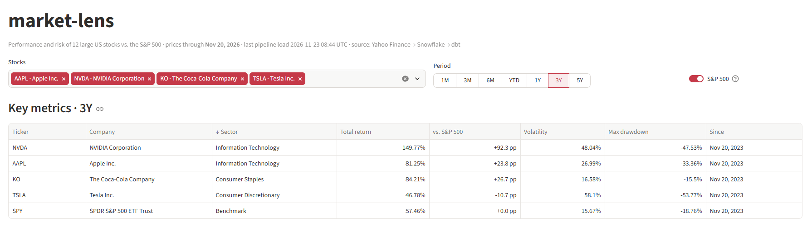
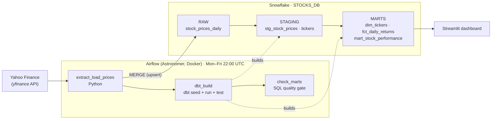
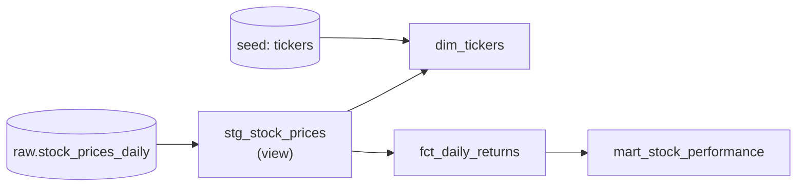
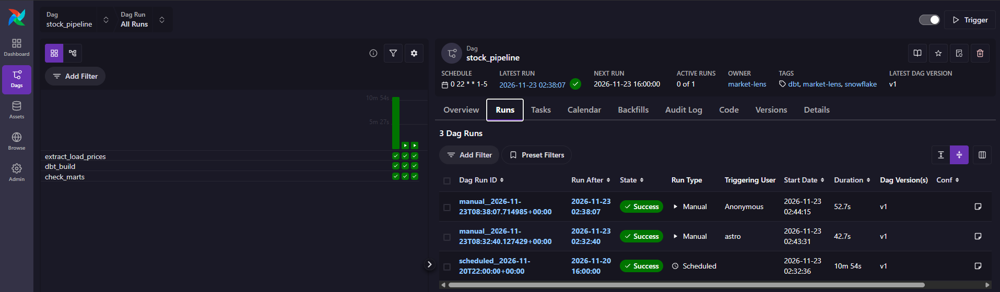
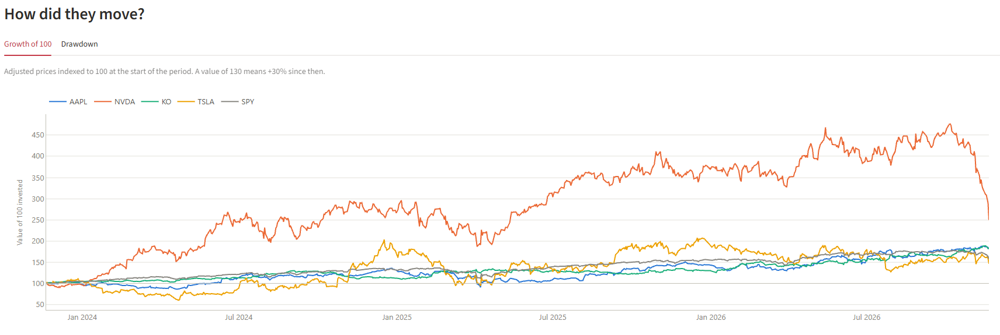
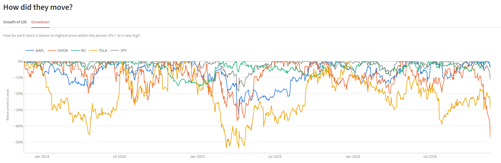
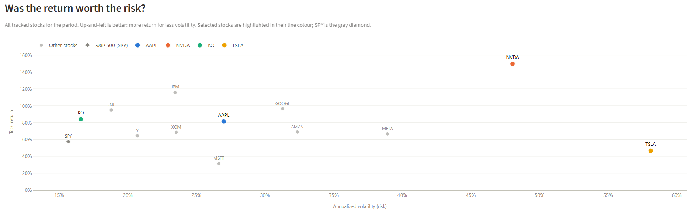

# market-lens

**An end-to-end data pipeline that tracks the performance and risk of 12 large US stocks against the S&P 500, refreshed every trading day.**

Daily prices are pulled from Yahoo Finance, loaded into **Snowflake**, modeled with **dbt**, orchestrated by **Airflow** and explored in an interactive **Streamlit** dashboard.


<sub>Filters and key metrics for the selected stocks over 3 years, with the S&P 500 (SPY) as the reference row. More screenshots in <a href="#4-visualize-streamlit-dashboard">the dashboard section</a>.</sub>

---

## Questions the dashboard answers

- **Performance:** how did each stock develop over the last 1M / 3M / 6M / YTD / 1Y / 3Y / 5Y, and did it beat the market (SPY)?
- **Risk:** how volatile was it, and what was the worst peak-to-trough loss (maximum drawdown)?
- **Risk vs. return:** did higher returns actually come with higher price swings?

## Architecture



| Layer | Tool | What it does |
|---|---|---|
| Extract | Python + `yfinance` | Downloads 5 years of daily OHLCV prices for 13 tickers (~16k rows) |
| Load | `snowflake-connector-python` | `write_pandas` into a temporary table, then `MERGE` into `RAW` on (ticker, date) |
| Transform | dbt 1.12 + `dbt_utils` | 1 seed, 4 models, 33 data tests, source freshness check |
| Orchestrate | Airflow 3 (Astro Runtime) | Daily DAG: extract/load → dbt build → data quality check |
| Visualize | Streamlit + Plotly | Filters, KPI table, indexed performance, drawdown and risk/return charts |

## How the pipeline works

### 1. Extract & load: idempotent and always current

[`airflow/include/ingestion/`](airflow/include/ingestion)

- **Ticker list in one place:** the tickers come from the dbt seed [`tickers.csv`](airflow/include/stock_dbt/seeds/tickers.csv), so the downloaded tickers and `dim_tickers` can never drift apart.
- **Full window every run:** each run re-downloads the **full 5-year window**, not just the latest day. Adjusted prices are retroactively restated after dividends and splits, so an append-only load would corrupt the return history.
- **Idempotent upsert:** rows are upserted with a single atomic `MERGE`:

  ```sql
  MERGE INTO RAW.STOCK_PRICES_DAILY t USING <temp table> s
  ON t.TICKER = s.TICKER AND t.PRICE_DATE = s.PRICE_DATE
  WHEN MATCHED     THEN UPDATE SET ...   -- restated prices are corrected
  WHEN NOT MATCHED THEN INSERT ...       -- new trading days are added
  ```

  Re-running the pipeline never creates duplicates: the first load inserted 16,315 rows, and a re-run inserted 0 and updated 16,315.
- **Safeguards:**
  - The download is retried with backoff.
  - The run fails if any ticker returns no data, so a partial download never reaches Snowflake.

### 2. Transform: dbt models

[`airflow/include/stock_dbt/`](airflow/include/stock_dbt)



| Model | Schema · type | Grain | Contents |
|---|---|---|---|
| `stg_stock_prices` | STAGING · view | ticker × day | Cleaned, typed raw prices; rows without a valid adjusted close removed |
| `dim_tickers` | MARTS · table | ticker | Company name, sector, benchmark flag, first/last price date |
| `fct_daily_returns` | MARTS · table | ticker × day | Daily return, running peak, drawdown from peak |
| `mart_stock_performance` | MARTS · table | ticker × period | Total return, annualized volatility, max drawdown for 1M … 5Y |

**Metric definitions** (all based on the split- and dividend-adjusted close):

| Metric | Definition |
|---|---|
| Total return | `end_price / start_price − 1` |
| Annualized volatility | Sample standard deviation of daily returns × √252 (trading days per year) |
| Max drawdown | Largest decline from a running peak *within the period*: `min(price / running_peak − 1)` |

Periods are anchored on the latest trading day. Each one starts on the first trading day on or after its start date; YTD is measured from the last close of the previous year.

**Data quality:**
- **Generic tests:** `unique` / `not_null`, `dbt_utils.unique_combination_of_columns` on every grain, `relationships` to `dim_tickers`, and `accepted_values` for periods.
- **Singular test:** [`assert_drawdowns_in_valid_range`](airflow/include/stock_dbt/tests/assert_drawdowns_in_valid_range.sql) checks that every drawdown lies in [−100%, 0%].
- **Freshness:** a source freshness check warns after 3 days and errors after 5.
- **Documentation:** every model and column is documented in the `schema_*.yml` files.

A custom [`generate_schema_name`](airflow/include/stock_dbt/macros/generate_schema_name.sql) macro makes `+schema: MARTS` create exactly `MARTS`, instead of dbt's default `STAGING_MARTS`.

### 3. Orchestrate: Airflow DAG

[`airflow/dags/stock_pipeline.py`](airflow/dags/stock_pipeline.py)

```
extract_load_prices  >>  dbt_build  >>  check_marts
```

- **Schedule:** `0 22 * * 1-5`, Mon–Fri after the New York market close. `catchup=False`, `retries=2`, one active run at a time.
- **`dbt_build`:** runs `dbt deps` and `dbt build` with a `BashOperator`. Snowflake credentials reach dbt as environment variables.
- **`check_marts`:** a `SQLCheckOperator` that fails the run if the marts are empty, older than 5 days, or missing ticker × period rows.
- **Connection:** Airflow uses `snowflake_default`, defined as an environment variable (`AIRFLOW_CONN_SNOWFLAKE_DEFAULT`) rather than through the UI, so the setup is reproducible.


<sub>The <code>stock_pipeline</code> DAG in the Airflow UI: every task succeeded in all runs, and the next run is scheduled.</sub>

### 4. Visualize: Streamlit dashboard

[`dashboard/`](dashboard)

| Component | Source model | Purpose |
|---|---|---|
| Filters: stocks (≤ 8), period, benchmark toggle | — | Drive every component below |
| Key metrics table | `mart_stock_performance` | Return, return vs. S&P 500 (pp), volatility, max drawdown |
| *Growth of 100* line chart | `fct_daily_returns` | Prices indexed to 100 at the period start, so stocks at any price level are comparable |
| *Drawdown* line chart | `fct_daily_returns` | How far each stock is below its peak within the period |
| Risk vs. return scatter | `mart_stock_performance` | All 13 tickers: volatility (x) vs. total return (y) |

**Growth of 100:** what $100 invested at the start of the period would be worth. A value of 250 means +150%.



**Drawdown:** how far each stock is below its highest price within the period. It shows the size and length of losses that the total return hides.



**Risk vs. return:** all 13 tickers for the selected period. Up-and-left is better: more return for less volatility. Selected stocks keep their line color.



**Chart design:**
- **Color palette:** the 8-color palette has been checked for color-vision deficiencies, with separate steps for light and dark mode.
- **Stable colors:** a stock keeps its color while it stays selected.
- **Benchmark:** the SPY benchmark is always neutral gray.
- **Labels:** every scatter point is labeled with its ticker, so identity never depends on color alone.
- **Caching:** queries are cached for one hour (`st.connection(..., ttl="1h")`).

## Repository structure

```
market-lens/
├── README.md
├── pyproject.toml / uv.lock      local Python env (uv): dbt, ingestion, Streamlit
├── .env.example                  template for the two git-ignored .env files
├── snowflake/
│   └── setup.sql                 one-time DDL: database, schemas, RAW table
├── airflow/                      Astro project (Docker)
│   ├── Dockerfile                Astro Runtime 3.4
│   ├── requirements.txt          yfinance, dbt-snowflake, Snowflake provider
│   ├── dags/stock_pipeline.py    the DAG
│   ├── tests/dags/               DAG integrity tests (astro dev pytest)
│   └── include/
│       ├── ingestion/            extract (yahoo_finance.py) + load (snowflake_loader.py) + local runner
│       └── stock_dbt/            dbt project (inside include/ so it is part of the Docker image)
│           ├── models/staging/   _sources.yml, stg_stock_prices
│           ├── models/marts/     dim_tickers, fct_daily_returns, mart_stock_performance
│           ├── seeds/            tickers.csv (ticker universe)
│           ├── tests/            singular data tests
│           └── macros/           generate_schema_name override
├── dashboard/
│   ├── app.py                    page layout and filters
│   ├── queries.py                cached Snowflake queries
│   └── charts.py                 Plotly figures and color system
└── docs/images/                  screenshots
```

## Running it yourself

### Prerequisites

- **Local tools:** [uv](https://docs.astral.sh/uv/), [Astro CLI](https://www.astronomer.io/docs/astro/cli/install-cli) and Docker.
- **Snowflake:** an account with [key-pair authentication](https://docs.snowflake.com/en/user-guide/key-pair-auth) set up for your user.

### 1. Snowflake

Run [`snowflake/setup.sql`](snowflake/setup.sql) once in a Snowflake worksheet.

### 2. Credentials

There are two git-ignored `.env` files with the same variables. Only the key path differs: a host path locally, a container path in Docker. See [`.env.example`](.env.example).

```bash
cp .env.example .env              # local: SNOWFLAKE_PRIVATE_KEY_PATH=C:/path/to/rsa_key.p8
cp .env.example airflow/.env      # Airflow: /usr/local/airflow/include/rsa_key.p8 + AIRFLOW_CONN_... line
cp /path/to/rsa_key.p8 airflow/include/rsa_key.p8   # git-ignored
```

### 3. Local run (without Airflow)

```bash
uv sync
cd airflow && uv run python -m include.ingestion.run          # extract + load (--dry-run to only download)
cd include/stock_dbt && uv run --env-file ../../../.env dbt deps
uv run --env-file ../../../.env dbt build                     # seed + models + tests
```

### 4. Airflow

```bash
cd airflow
astro dev start          # UI at http://localhost:8080; unpause and trigger `stock_pipeline`
astro dev pytest         # DAG integrity tests
astro dev stop
```

### 5. Dashboard

```bash
cd dashboard
uv run streamlit run app.py   # http://localhost:8501
```
